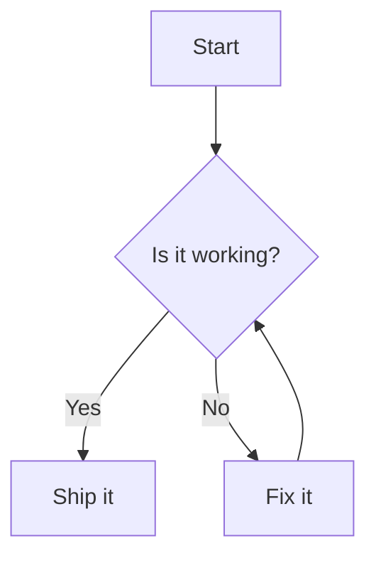

# Mermaid Live Editor – Blazor Showcase Application

An interactive **Blazor showcase application** that enables users to **write Mermaid syntax and instantly generate visual diagrams** with a live preview. This sample demonstrates how Mermaid diagrams can be authored, rendered, and exported within a modern Blazor UI, making it ideal for documentation, architecture design, and technical communication.

This application delivers a **Mermaid Live Editor experience in Blazor**, allowing users to create flowcharts, sequence diagrams, class diagrams, state diagrams, ER diagrams, Gantt charts, and more—directly from text-based Mermaid definitions.

---

## Why Use This Mermaid Live Editor Showcase?
- Author diagrams using simple, readable **Mermaid text syntax**
- Get **instant visual feedback** with live diagram rendering
- Easily switch between different diagram types
- Export diagrams for docs, READMEs, and presentations

**Keywords:** Blazor Mermaid editor, Mermaid live preview, Mermaid diagram generator, flowchart editor, sequence diagram, Blazor showcase, Mermaid syntax visualizer.

---

## Key Features

### Mermaid Syntax Editor
- Text-based editor to type or paste Mermaid definitions
- Supports common diagram types:
  - Flowcharts
  - Sequence diagrams
  - Class diagrams
  - State diagrams
  - Entity Relationship diagrams
  - Gantt charts

### Live Diagram Rendering
- Real-time or on-demand rendering as users edit Mermaid code
- Smooth visual updates without page reloads
- Graceful error handling for invalid Mermaid syntax

### Themes and Styling
- Light and dark mode support
- Built-in Mermaid themes: `default`, `dark`, `neutral`, `forest`
- Mermaid configuration options for colors, fonts, and spacing

### Interactions
- Zoom and pan for large diagrams
- Fit-to-view and reset options
- Fully responsive layout for desktop, tablet, and mobile

### Export Options
- Export diagrams as **SVG** or **PNG**
- Copy Mermaid source or rendered output for reuse
- Ideal for documentation, blogs, and presentations

### Accessibility
- Keyboard-friendly editor interactions
- High-contrast theming options
- Clear syntax error messages

---

## Dependencies

### Runtime / Framework
- Blazor Server or Blazor WebAssembly
- Target framework: **.NET 8.0**

### NuGet / Libraries
- Blazor UI components for layout and controls
- JavaScript interop for Mermaid rendering
- Mermaid JavaScript library

### Static Assets
- Mermaid JS bundle
- Application styles (Bootstrap, Fluent, Material, or custom)

---

## Deployment

### Requirements to Run the Demo
- [Visual Studio 2022](https://visualstudio.microsoft.com/vs/)
- [.NET 8.0 SDK](https://dotnet.microsoft.com/download)

### How to Run
1. Clone the repository.
2. Open the solution in Visual Studio 2022.
3. Restore all NuGet packages.
4. Press **F5** to run with debugging or **Ctrl + F5** without debugging.

---

## Output


---

## Usage

### Basic Example

#### 1) Write Mermaid Syntax
Type or paste Mermaid code into the editor panel.

Example – Flowchart:

You can author different diagram types such as **flowcharts, sequence diagrams, class diagrams, state diagrams, ER diagrams, and Gantt charts** using standard Mermaid syntax.

---

### 2) Live Preview Rendering
As you type or click **Render**, the Mermaid definition is parsed and rendered instantly in the preview pane.

- The diagram updates without a page refresh
- Syntax errors are displayed with helpful messages
- Rendering can be configured as **live** (on change) or **manual** (on button click)

---

### Blazor Integration Example (Concept)
The following simplified Razor snippet demonstrates how Mermaid syntax is rendered using JavaScript interop in a Blazor application.

```razor
<textarea @bind="MermaidCode" class="editor"></textarea>

<button @onclick="RenderDiagram">Render</button>

<div id="diagramContainer"></div>

@code {
    string MermaidCode = "flowchart TD\nA-->B";

    async Task RenderDiagram()
    {
        await JS.InvokeVoidAsync("renderMermaid", MermaidCode, "diagramContainer");
    }
}


### Rendering Strategy
- Mermaid syntax is maintained as a Blazor state variable.
- The content is passed to **Mermaid.js** via JavaScript interop.
- Mermaid parses the text input and generates **SVG output**.
- Any parsing or rendering errors are captured and surfaced to the UI for user feedback.

---

### Customizing for Your Use Case

#### Editor Enhancements
- Add predefined Mermaid templates (Flowchart, Sequence, Class, etc.).
- Enable syntax validation and auto-formatting.
- Integrate syntax highlighting for better readability.

#### Diagram Configuration
- Toggle between **live preview** and **manual rendering**.
- Persist Mermaid source code using local storage or backend storage.
- Provide actions such as **clear**, **reset**, and **load sample diagrams**.

---

### Styling and Themes
Customize the appearance of diagrams using Mermaid configuration options.

```javascript
mermaid.initialize({
  theme: "dark",
  flowchart: {
    curve: "basis"
  }
});
```
- Switch themes dynamically from the UI.
- Customize colors, fonts, spacing, and layout behavior.

---

### Best Practices
- Keep Mermaid definitions concise and readable.
- Split very large diagrams using subgraphs.
- Validate Mermaid syntax before rendering.
- Throttle live preview updates for complex diagrams.
- Use SVG export for high-quality documentation output.

